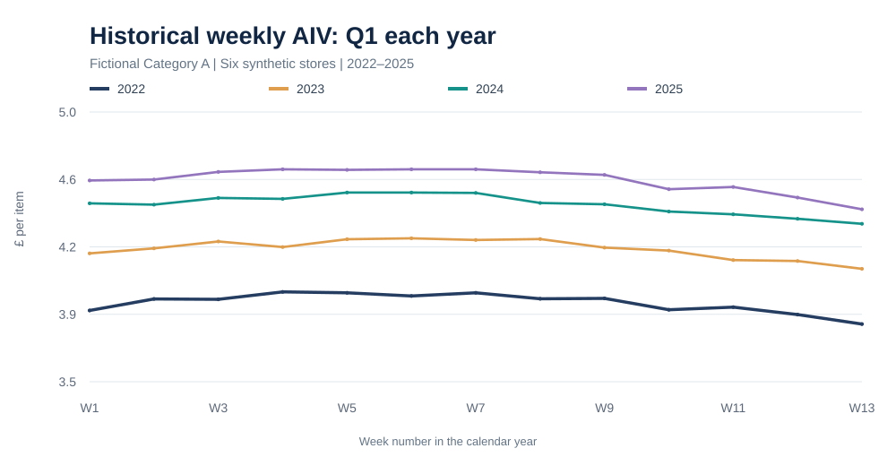
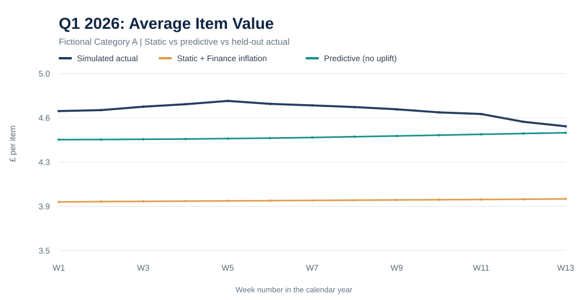
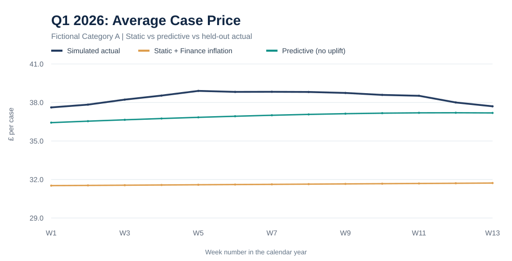
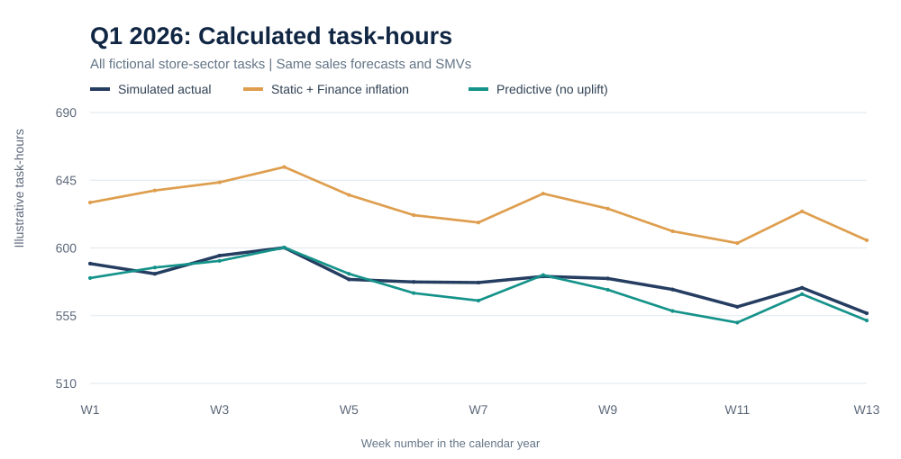
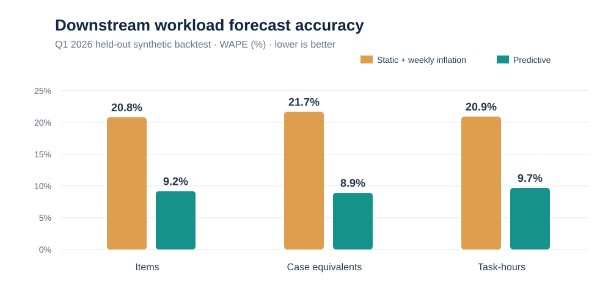

# Findings — AIV/ACP and Labour-Workload Forecasting (Synthetic Q1 2026)

> **Important:** These are generated results from a **fully fictional simulation**, not from a retailer's historical records or an employer's production labour model. The demonstration was prepared with AI assistance. No commercial benefits, real actual hours or productivity improvements have been demonstrated.

## Executive finding

Using **2022–2025 synthetic weekly data**, a direct regression forecast of 2026 weekly AIV and ACP produced lower errors than a **2025 flat-period reference value adjusted weekly using fictional Finance inflation assumptions**. The effect remained visible after both methods were fed through the **same** sales forecast, sector mix, and task-hour conversion.

The most consequential metric in the controlled simulation was **task-hours WAPE**, falling from **20.929%** to **9.702%**, a reduction of **11.227 percentage points** (approximately **53.6% relative reduction**). This is **only a result of the simulated data-generating assumptions**.

## Experimental setup

| Control | Choice |
| --- | --- |
| Historical observations | **4,992** store–sector–week records, 2022–2025 |
| Store and sector identifiers | **6 fictional stores × 4 fictional sectors** |
| Holdout | **312** store–sector–week records, 2026 weeks 1–13 |
| Baseline AIV/ACP | **2025 weeks 18–30**, pooled as total sector sales divided by total units, per fictional store-sector |
| Baseline inflation | Fictional Finance annual scenarios of **2.6% (late 2025)** and **2.8% (Q1 2026)**, compounded as proportional weekly increases |
| Predictive model | Ridge on **log nominal AIV** and **log nominal ACP**, with calendar time, annual seasonality and fictional series identity |
| Additional inflation uplift on predictive model | **None** |
| Sales forecast, mix, time standards | **Identical** for both approaches |
| Actuals for evaluation | Synthetic 2026 sales, item counts, case equivalents and derived task-hours, **unseen during training** |

The initial ratio histories intentionally include year-to-year inflation-like drift and systematic weekly seasonal mix/price changes. In that environment, a calendar model has information the annual-flat-period baseline does not represent. This design makes the case for **testing** more adaptive ratios but does not establish superiority on real datasets.

## 1. Historical AIV is not necessarily constant within the year



The price-level component moves upward across years, while a recurring seasonal pattern persists within Q1. Holding an annual reference ratio flat cannot represent both changes perfectly.

However, actual market inflation also varies, and **historical year-on-year inflation does not directly justify a particular weekly forecast or seasonal correction**.

## 2. Forecast the conversion drivers





| Driver, store–sector–week level | Static + weekly inflation | Direct prediction |
| --- | ---: | ---: |
| AIV MAE (£/item) | 1.6514 | **0.9095** |
| AIV RMSE (£/item) | 1.8072 | **1.0471** |
| AIV WAPE | 21.998% | **12.116%** |
| AIV signed bias (predicted − actual) | +0.4198 | +0.3807 |
| ACP MAE (£/case) | 13.6991 | **8.1464** |
| ACP RMSE (£/case) | 14.6124 | **9.1692** |
| ACP WAPE | 19.416% | **11.546%** |
| ACP signed bias (predicted − actual) | +0.2103 | +2.8045 |

**Do not ignore bias:** the model improved ACP absolute error but had a **larger positive signed ACP bias** than the static comparator. The more positive the ACP forecast error at fixed sales, the fewer cases it predicts. That can matter to operational sufficiency even when MAE improves.

## 3. Translate both forecasts into identical workload calculations

Using each method's predicted ratio:

```text
Forecast division sales × fixed sector mix → Forecast sector sales

Item-driven tasks: sector sales ÷ predicted AIV → items
Case-driven tasks: sector sales ÷ predicted ACP → case equivalents

Appropriate forecast volume × matching fictional SMV ÷ 60 → task-hours
```

This simulation assigns two categories to item-based work and two to case-based work. It **does not add AIV-based and ACP-based estimates for the same task**.



### The downstream metrics matter more than the ratio metrics



| Synthetic 2026 metric | Static + inflation | Direct predictive model | Difference |
| --- | ---: | ---: | ---: |
| **Items WAPE** | 20.834% | **9.193%** | −11.641 percentage points |
| **Case equivalents WAPE** | 21.682% | **8.924%** | −12.758 percentage points |
| **Task-hours WAPE** | 20.929% | **9.702%** | −11.227 percentage points |
| Items signed bias | +372.4631 | −0.1103 | Direction improved in simulation |
| Case equivalents signed bias | +57.3625 | −3.6810 | Direction improved in simulation |
| Task-hours signed bias | +1.9892 | −0.2081 | Direction improved in simulation |

Errors are calculated at the **store × sector × week** level before summarising into overall WAPE; the chart of aggregate weekly hours is a separate presentation view. In particular, aggregate curves may conceal offsetting errors.

**Crucial control:** both approaches use exactly the same Q1 2026 **forecast sales** and fixed sector mix. The baseline inflation assumptions and modelled conversion ratios are the only methodological difference in projected volumes. Simulated actual sales differ slightly from the shared forecasts, creating a realistic additional error source that affects both approaches.

## 4. Does this justify a change to the real labour model?

**No operational change can be justified from this synthetic result.**

What the experiment demonstrates is how to test the idea without confusing **higher/lower allocated hours** with **more accurate hours**:

- **First:** establish that future AIV and ACP predictions are better calibrated than the static assumptions, including bias and out-of-time stability.
- **Second:** show that errors in *forecast items and cases* decrease using the actual sales forecast available at the planning origin.
- **Third:** determine whether the better volume estimates improve task-level workload forecasts after applying the appropriate processing time.
- **Finally:** separately evaluate fixed hours, stock movement, deliveries, availability, planning constraints, the shape of day, and the implications for overall staffing.

### Important limitations

1. **Constructed seasonality:** the synthetic generator contains recurring seasonal signals, so this challenger was expected to exploit calendar patterns better than a flat-period baseline.
2. **Limited horizon:** one held-out 13-week quarter, not multiple genuine years of backtesting.
3. **Simplified inflation:** historical synthetic price movements and fictional Finance assumptions are not published UK inflation figures or internal Finance plans. A real backtest must preserve publication dates and forecast origins.
4. **Nominal-value consistency:** both forecasts are nominal AIV/ACP. Adding extra inflation to the model would risk **double counting** learned price trends.
5. **Case equivalents versus handled cases:** sales-derived case equivalents may not equal receipts, deliveries, replenishment or warehouse handling. That mapping requires validation.
6. **Illustrative standards:** task SMVs are invented and fixed; calculated task-hours are *not* actual scheduled or paid hours.
7. **No direct-items challenger:** it remains possible that forecasting items directly performs better than estimating them from sales and future AIV; that is a legitimate comparison for future work.
8. **Static baseline interpretation:** reference weeks 18–30 are explicitly a simulated relatively flat period; choosing that period using future test results would be inappropriate in a real study.

## Conclusion

**This public simulation supports the feasibility of the experimental design, not its real-world efficacy.** It demonstrates that forecasting conversion ratios can change derived item/case volumes and can materially change calculated task-hours even when sales forecasts remain identical. Determining whether this is genuinely *more accurate* in production requires authorised historical item/case truth, fair forecast-origin backtesting and separate workload validation.

## Reproducibility

From the project directory:

```bash
python -m pip install -r requirements.txt
python -m src.experiment
python -m unittest discover -s tests -v
```

Expected generated files: `outputs/synthetic_results.json`, `outputs/synthetic_holdout_predictions.csv` and five SVGs under `outputs/figures/`. The five figures embedded in this document are committed static snapshots of the same seeded simulation. Results will change if the generator or model is modified; the published metrics should then be regenerated and updated.
