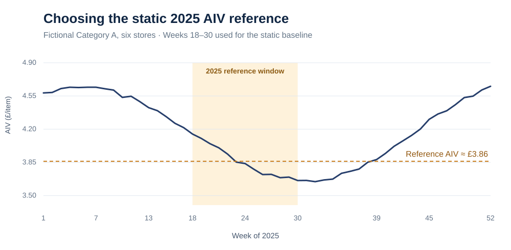
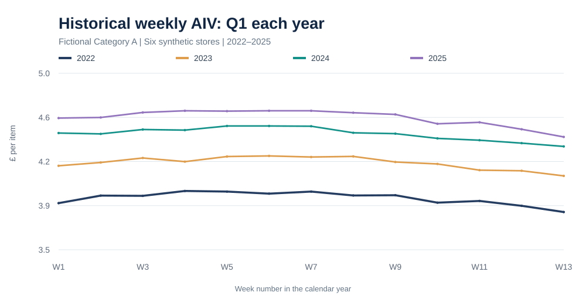
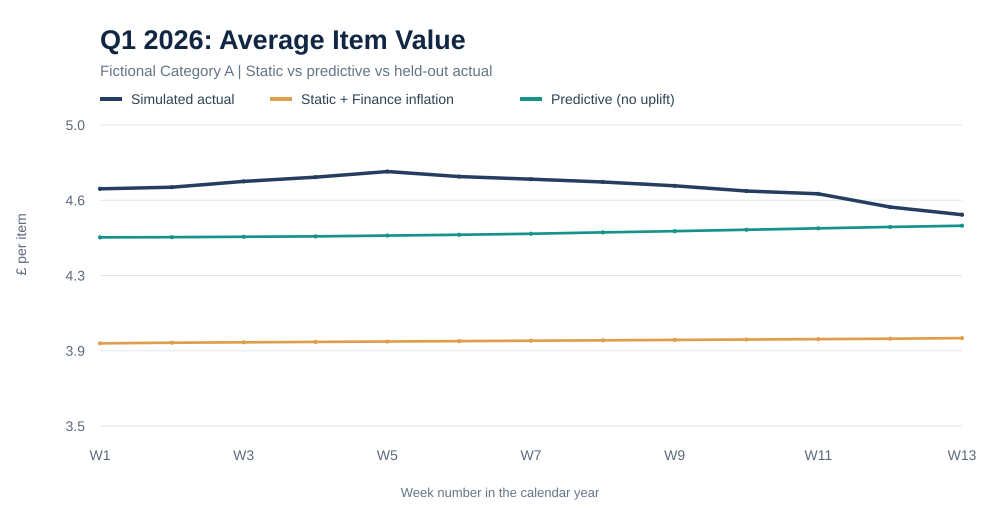
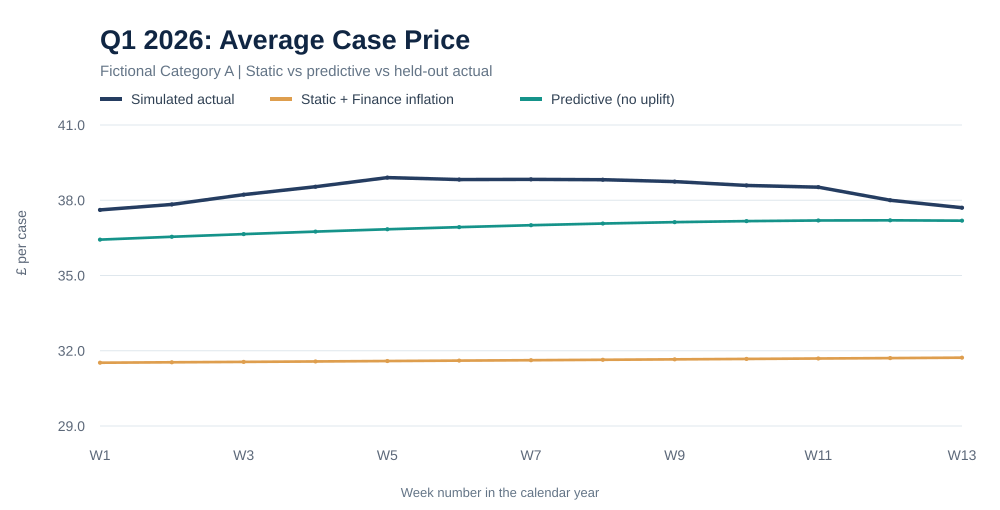
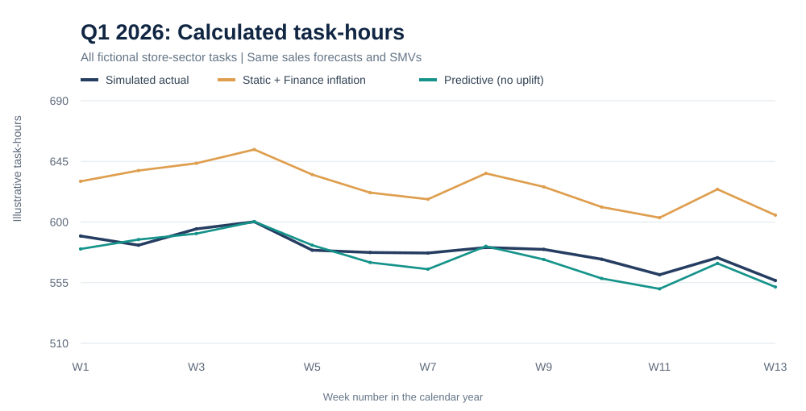
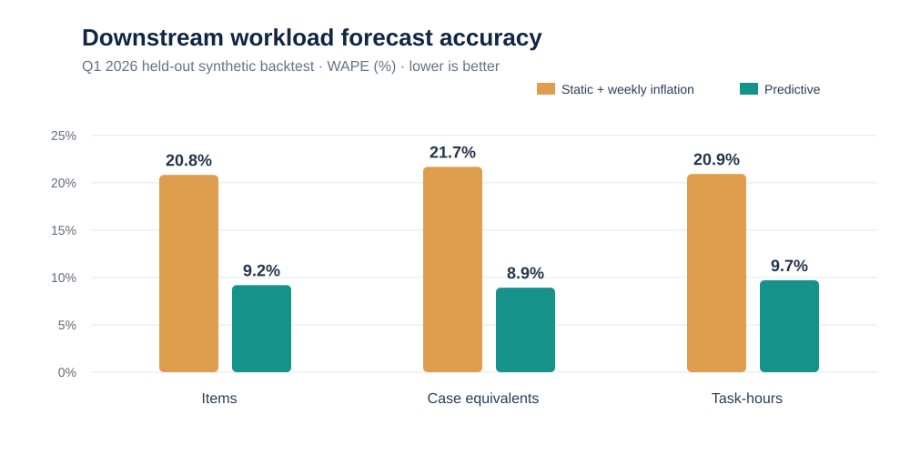

# Predicting AIV and ACP to Improve Retail Labour Requirements

**A controlled comparison of static conversion drivers and direct predictive modelling, using synthetic 2022–2026 weekly data.**

**Skills:** Python, pandas, scikit-learn, time-series backtesting, seasonality, forecasting, workload modelling, data governance

> **Privacy and provenance:** This is an **AI-assisted public reconstruction** of a research idea explored in an earlier project. Every store, category, price, sales figure, inflation rate and task time standard is **fictional**. The results below are from this **synthetic experiment**, not measured workplace performance or original study results. No company name, internal data or proprietary model settings are included.

## 1. The reason for the project

Retail labour planning can start from a forecast of **sales value (£)**. However, many physical store activities depend on **how many items or cases must be handled**, rather than just the monetary value of sales.

**AIV (Average Item Value)** and **ACP (Average Case Price)** make it possible to derive physical volumes from forecast sales. They are legitimate value-to-quantity conversion ratios — not arbitrary multipliers:

| Historically observed ratio | Definition | Future estimate from planned sector sales |
| --- | --- | --- |
| **AIV (£/item)** | Total sector sales ÷ items sold | **Estimated items = forecast sector sales ÷ forecast AIV** |
| **ACP (£/case)** | Total sector sales ÷ case equivalents | **Estimated cases = forecast sector sales ÷ forecast ACP** |

To identify sector sales, this simplified example first multiplies the *division* sales forecast by a fixed **sector sales mix**. For item-led case activities, items may also be converted with **IPC (items per case)**. After choosing the appropriate item- or case-based volume, an applicable **SMV (Standard Minute Value)** estimates task time: `task-hours = forecast units × minutes per unit / 60`.

This is a coherent and interpretable **sales-derived quantity forecasting method** because value = average price × quantity. But a future quantity forecast is only as good as its sales forecast and future conversion ratio. The ACP route estimates **case equivalents implied by sales**, which are not automatically physical deliveries or replenishment volumes. The method must be evaluated against actual volumes.

### The weakness this project tests

The **current-method reconstruction** starts with average AIV/ACP from a relatively flat reference period **in the previous year** and changes those ratios using Finance-supplied weekly inflation assumptions. With the sales forecast and sector mix held fixed, changes in calculated workload are then driven only by **forecast sales and adjusted AIV/ACP through inflation**. The model does not independently predict how seasonal product mix and other changes affect the value per item or case.

The research question is:

> **Could predicting future AIV and ACP directly from historical weekly data give more accurate items, case equivalents and task-hour requirements than static previous-year ratios adjusted only for inflation?**

This experiment tests the **calculation of workload demand**, not an ability to directly control physical work. Calculated variable hours are not necessarily actual scheduled or paid hours.

## 2. Experimental design — Q1 2026

We use **four historical years, 2022–2025** (52 fictional weekly periods per year), to predict the first 13 weeks of 2026. All original data are replaced by synthetic observations with **fictional inflation-like price trends and weekly seasonal variation**.

| | Method A: Current-method reconstruction | Method B: Predictive challenger |
| --- | --- | --- |
| Reference information | 2025 flat weeks **18–30** | Weekly observations **2022–2025** |
| Conversion-driver calculation | 2025 flat-period total sales ÷ total items/cases | Ridge regression on log(AIV)/log(ACP), using historical ratios, calendar trend, seasonal Fourier terms and fictional store/sector categories |
| Forecast inflation | Apply fictional Finance-style annual assumptions **as weekly compounded adjustments** (2.6% for remaining 2025 and 2.8% for early 2026) | **No standalone inflation uplift and no inflation feature**. Trends in nominal historical ratios can be learned indirectly |
| 2026 sector sales | **Identical** sector sales forecast | **Identical** sector sales forecast |
| SMVs and sector mix | **Identical** fictional fixed assumptions | **Identical** fictional fixed assumptions |
| Test window | Q1 2026 **13 weeks entirely held out** | Same 13 weeks |

The synthetic dataset contains **6 fictional stores × 4 fictional sectors × 208 historical weeks = 4,992 training observations**; the 2026 holdout contains **312 observations**. Historical AIV and ACP are constructed consistently from simulated sales and simulated physical quantities.

**No realised Q1 2026 ratio, item count, case count or actual sales value is supplied to the model or the static calculation.** Actual simulated volumes and actual simulated task-hours are used **only to score** both forecasts. Both methods use the same imperfect 2026 sales forecast, so sales forecast error affects both.

Read the method details in [WORKLOAD_LOGIC.md](WORKLOAD_LOGIC.md).

## 3. Synthetic findings

<details>
<summary><strong>Model comparison on the withheld Q1 2026 synthetic data</strong></summary>

| What we evaluate | Static + inflation WAPE | Predicted AIV/ACP WAPE |
| --- | ---: | ---: |
| AIV | 21.998% | **12.116%** |
| ACP | 19.416% | **11.546%** |
| Derived items | 20.834% | **9.193%** |
| Derived case equivalents | 21.682% | **8.924%** |
| Calculated variable task-hours | 20.929% | **9.702%** |

The model reduced **task-hours WAPE by 11.227 percentage points**, or approximately **53.6% relative to the static baseline**, on *this simulated dataset only*. It does not establish an employer productivity improvement or justify any staffing reductions.

</details>

### Where the 2025 static reference comes from



For the static model, the **2025 reference period is a selected relatively flat *trading/sales* period**, not a claim that AIV itself is flat. Its overall ratio is constructed as **sum of sector sales ÷ sum of items (or cases)** across the reference weeks for each store-sector. The figure shows the six-store Category A illustration (pooled AIV ≈ £3.84/item before weekly Finance-style adjustment). Using the individual weekly figures instead is precisely the additional information the predictive challenger seeks to exploit.

### Historical seasonality



Historical reference ratios change across years and within seasons. A single flat-period 2025 reference is not intended to represent every week of Q1 2026.

### Q1 2026 AIV: predicted versus static



### Q1 2026 ACP: predicted versus static



### What happens to calculated labour-hours?





The crucial finding is **downstream**: in this deliberately constructed dataset, learning weekly seasonal patterns improved the estimated units and task-hours compared with updating previous-year ratios through inflation alone. **The improvement is conditional on how the synthetic data were constructed**; it cannot be extrapolated to actual retail operations.

[Read the full results, interpretation and limitations](FINDINGS.md).

## 4. Run and reproduce

Install dependencies from the project directory:

```bash
python -m pip install -r requirements.txt
python -m src.experiment
python -m unittest discover -s tests -v
```

The script creates **six SVG charts**, a machine-readable results JSON file, and a **synthetic** holdout forecast CSV under `outputs/`. The output folder is ignored by Git. All visuals above are fixed snapshots from the same seeded synthetic demonstration; they do not contain genuine operational data.

The automated checks cover reproducibility, fictional identifiers, input/quantity consistency, chronological holdout separation, identical forecast sales, leakage safeguards, task-hour unit conversions and weekly inflation compounding.

## 5. What must be proved before operational use

- Verify that historic AIV/ACP and future sales are calculated at **matching sector/store/time grains**, with consistent treatment of discounts, VAT, returns and quantities.
- Evaluate **derived item and case errors** and the consequences of underforecasting, not simply the AIV/ACP error.
- Compare with other legitimate alternatives, including direct item-demand forecasting.
- Use only historic Finance assumptions or published inflation data **actually available at the historical forecast origin**; observed future inflation causes leakage.
- Check whether the predictive model already incorporates price inflation **before adding any adjustment** — never double-count nominal growth.
- Validate the difference between **sales-derived case equivalents** and genuinely delivered/replenished case workload.
- Confirm task-specific standards, fixed-hour requirements, planning constraints and business controls before translating task-hours into staffing decisions.

For the business calculation and weekly inflation principles, see [WORKLOAD_LOGIC.md](WORKLOAD_LOGIC.md). For the full GitHub Pages report, see [the portfolio case study](index.md).

**Status:** Complete synthetic proof of concept for review; **not** a validated production model. Independent review of any AI-assisted code and claims is recommended before attributing individual implementation work.
