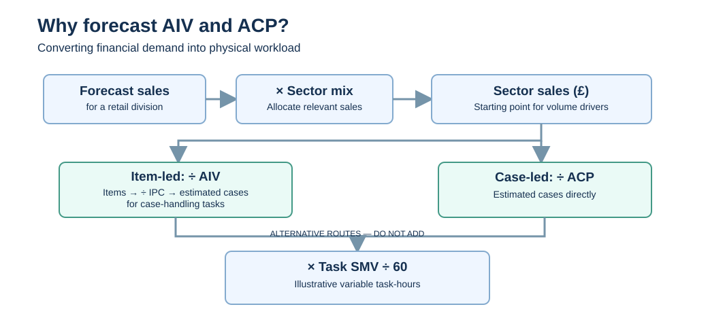

# Predicting AIV and ACP to Improve Retail Labour Requirements

**A data-science project connecting retail sales, physical workload and labour planning.**

> **Confidentiality:** This is a public, synthetic reconstruction. All example values, store IDs, sectors and models are fictional. It is not evidence of measured workplace results.

## Why this matters

Labour planning needs a forecast of the **work stores must actually carry out**, not only the monetary value of sales. The same £1,000 of sales can represent very different amounts of handling depending on the products involved. Therefore, a sales forecast alone may not explain whether a team will need to handle 50 cases or 100.

The purpose of this research is to test whether **predicting the value-per-item and value-per-case drivers** used in workload calculations could improve estimated volumes and, through appropriate task standards, the **labour-hours requirement**.

**Research question:** Can predictions of AIV and ACP, with validated quarterly adjustments, estimate future item and case workload more accurately than assumptions held constant across the year?

## What are AIV and ACP?

| Driver | Definition | Purpose |
| --- | --- | --- |
| **AIV: Average Item Value** | Average value of sales per item (£/item) | Convert sector sales into estimated items |
| **ACP: Average Case Price** | Average value of sales per case (£/case) | Convert sector sales into estimated cases |
| **Mix** | Sector's share of division sales | Attribute a sales forecast to the appropriate sector |
| **IPC: Items Per Case** | Number of items per case | Convert item volume to cases where needed |
| **SMV: Standard Minute Value** | Expected minutes for the applicable activity | Convert the relevant task volume into minutes and hours |

AIV and ACP are **alternative conversion approaches**, not two estimates to add together.

## The business calculation

The conceptual process starts with `division forecast sales × sector mix`. The resulting sector sales are divided by **AIV** to derive items, or **ACP** to derive cases. An AIV-based item estimate can be converted to cases using **IPC**, if the task is measured in cases. Then, the relevant volume is multiplied by the matching **SMV** and divided by 60 to derive variable task-hours.

These are **task-level illustrative hours**, not the complete staffing requirement. Fixed hours, other tasks, activity profiles and planning constraints must be considered separately.

## A small example: why quarter-specific assumptions could change the forecast

All values below are invented for explanation.

| Step | Value |
| --- | ---: |
| Forecast division sales | £120,000 |
| Sector mix | 25% |
| Forecast sector sales | **£30,000** |
| Static annual ACP | £60 per case |
| **Cases estimated using annual ACP** | **500** |
| Quarter-specific ACP (illustrative) | £75 per case |
| **Cases estimated using quarterly ACP** | **400** |
| Case-handling SMV | 2.4 minutes per case |
| **Task hours using annual ACP** | **20 hours** |
| **Task hours using quarterly ACP** | **16 hours** |

In this fictional example, the static annual assumption overestimates case-handling demand by four task-hours. If the actual quarterly ACP were lower than the annual assumption, the direction of the error would be reversed.

**This is the business reason for predictive modelling:** a better driver forecast could improve the number of items and cases used in workforce planning. But this still needs evidence: lower AIV/ACP error is not automatically lower workload-hours error.

## Data science approach

1. Build a historical panel of **fictional** stores, product sectors, years, AIV, ACP and seasonal observations.
2. Explore trend and seasonal variation, while separating genuine predictive features from assumed quarterly multipliers.
3. Compare candidate models with a simple historic-value benchmark using chronologically held-out data.
4. Evaluate error and **signed bias** in AIV and ACP.
5. Translate alternative driver assumptions into estimated items, cases and **illustrative task-hours** to show why model quality matters operationally.

**Current status:** a synthetic exploratory dataset and initial modelling code are available. Evaluation charts and model findings still require execution and review. The worked example above is a calculation illustration, **not a reported model improvement**.

## Findings and limitations

This version establishes the **business mechanism and research hypothesis**, not validated results. Before concluding that the approach improves resource planning, it must demonstrate that predicted conversion drivers perform better on future data, that their volume estimates are more accurate, and that task-hour sensitivity is meaningful. Overall staffing and cost savings cannot be inferred from this analysis.

[Read the full technical overview](README.md) · [Calculation assumptions and formulas](WORKLOAD_LOGIC.md) · [Browse the Python implementation on GitHub](https://github.com/Rolando-Villca/Rolando-Villca-DSPP/tree/main/projects/aiv-acp-predictive-modelling)

---

*Prepared as an AI-assisted public reconstruction of an earlier analytical investigation, with simulated inputs and no confidential employer records.*
