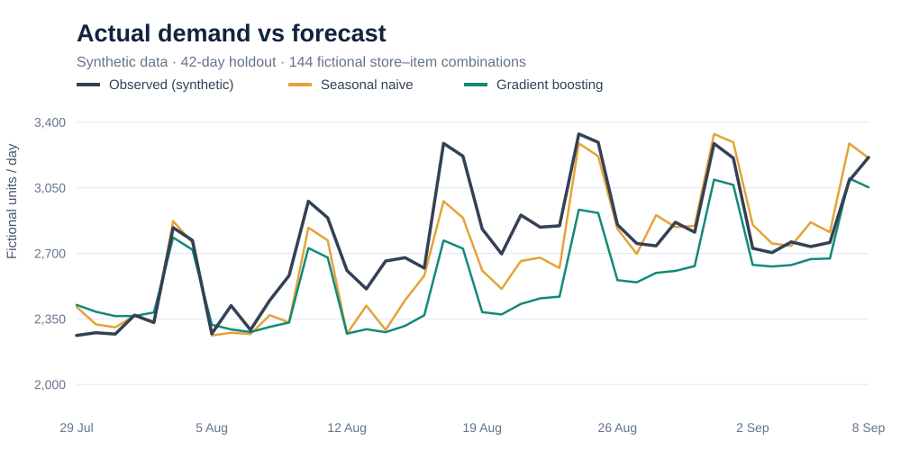
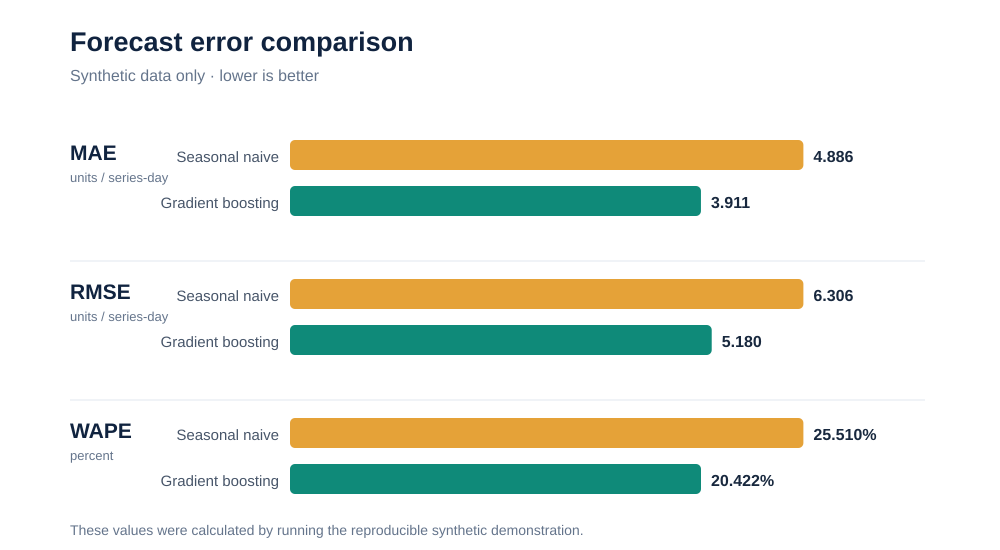
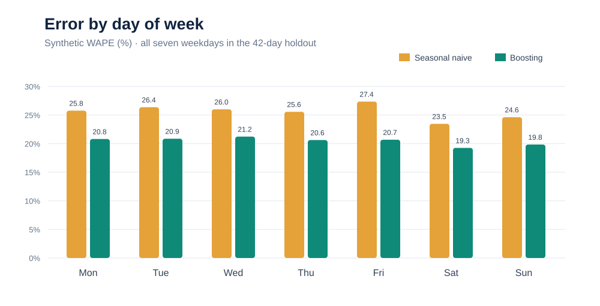

# Findings and Interpretation — Synthetic Retail Demand Forecasting

> **Data status:** All quantities, locations, products, times and results in this public demonstration are **fictional**. This is a reproducible methodological reconstruction, not an employer data extract or a disclosure of confidential measured business performance.

## Executive summary

A histogram-based gradient boosting regressor outperformed a **seven-day seasonal-naive** forecast on a synthetic test set of **6,048 store–item–day observations** over the **final 42 days** of a generated 252-day daily panel.

- **MAE:** 4.886 → **3.911** units (20.0% relative reduction).
- **RMSE:** 6.306 → **5.180** units (17.9% relative reduction).
- **WAPE:** 25.510% → **20.422%** (19.9% relative reduction).
- **Bias:** −0.434 → **−1.320** units (predicted minus observed): the challenger has **worse systematic underforecasting**, despite its improved absolute error.

These results are specific to the synthetic data generator, chosen model, fixed random seed and one chronological holdout. **They cannot be interpreted as operational performance, predicted savings, or evidence that a real retailer achieved these accuracy changes.**

## Visual 1 — Aggregate demand across the holdout



Both methods track broad weekday rhythms. Aggregated lines help communicate the overall shape of demand, but can conceal offsetting errors between stores and items. The reported test metrics therefore measure **individual fictional store–item–day forecasts**, not error on daily aggregate totals.

## Visual 2 — Benchmark comparison



| Performance measure | Seasonal naive | Gradient boosting | Interpretation |
| --- | ---: | ---: | --- |
| MAE (units) | 4.886 | **3.911** | Lower average magnitude of item-level error |
| RMSE (units) | 6.306 | **5.180** | Lower error when large misses are penalised |
| WAPE (%) | 25.510 | **20.422** | About 20.4 units of absolute error per 100 units of fictional demand |
| Signed bias (units) | −0.434 | **−1.320** | **Not better**: stronger underforecasting tendency |

Relative reductions use `(naive error − model error) / naive error`, rather than simply subtracting percentage points. Negative bias means predictions tend to fall below observed demand.

## Visual 3 — Performance by weekday



| Day | Seasonal naive WAPE | Boosting WAPE |
| --- | ---: | ---: |
| Monday | 25.77% | 20.81% |
| Tuesday | 26.37% | 20.86% |
| Wednesday | 26.00% | 21.22% |
| Thursday | 25.57% | 20.63% |
| Friday | 27.35% | 20.68% |
| Saturday | 23.46% | 19.25% |
| Sunday | 24.62% | 19.84% |

The model improves WAPE on every weekday in this particular artificial holdout. It does **not** demonstrate robustness over holidays, promotions, rare item events, changing product ranges or new stores.

## Methodological choices that matter

1. **Chronological evaluation.** The model trains only on days before the final 42-day test window; random splitting would misrepresent forecasting.
2. **Seven-day information cutoff.** Features at target day `t` use `t−7`, `t−14`, `t−28` and the historical window `t−13...t−7`. This prevents using transactions from the six immediately preceding days, which would be unavailable under the intended rolling seven-day forecast horizon.
3. **Baseline first.** A simple last-week forecast is a useful reference. Added complexity should be justified by reproducible gains and an operational benefit.
4. **Synthetic data constraints.** The generator deliberately creates stable demand, weekend effects and moderate seasonality, making it an educational demonstration rather than a realistic test of retail exceptions.

## What a genuine operational pilot would need

- Rolling-origin backtesting across multiple quarters, including high-demand seasonal events, and forecast-origin data cutoffs checked in production.
- An explicit cost-sensitive assessment of overforecasting versus underforecasting.
- Lower-volume and intermittent-demand categories, outlier policy, cold-start items and range changes.
- Future-known covariates (planned events, promotions, future price) rather than realised future information.
- Validation against logistics volumes, cases and actual task requirements **before** deriving any implication for labour capacity.
- Access controls, ownership, data quality checks, documentation and governance approval.

## Conclusion

In the synthetic teaching example, gradient boosting **reduced forecast error compared with repeating the previous week's demand**. However, the underforecast bias worsened and the synthetic setup is simplified. The defensible conclusion is that item-level time-series feature engineering and baseline comparison are worth investigating in a more realistic controlled pilot — **not that staffing or cost savings have already been demonstrated**.

## Reproducibility

From the project folder:

```bash
python -m pip install -r requirements.txt
python -m src.forecast
python -m src.create_figures
python -m unittest discover -s tests -v
```

The scripts generate new results in the local `outputs/` directory only. The three SVGs displayed above are committed synthetic-data snapshots for readers who do not execute Python.

**Attribution:** The public reconstructed code and explanatory documentation were prepared with AI assistance. The underlying research question and methodological direction derive from earlier project work. Independent review and adaptation are recommended before presenting the software as individually authored.
