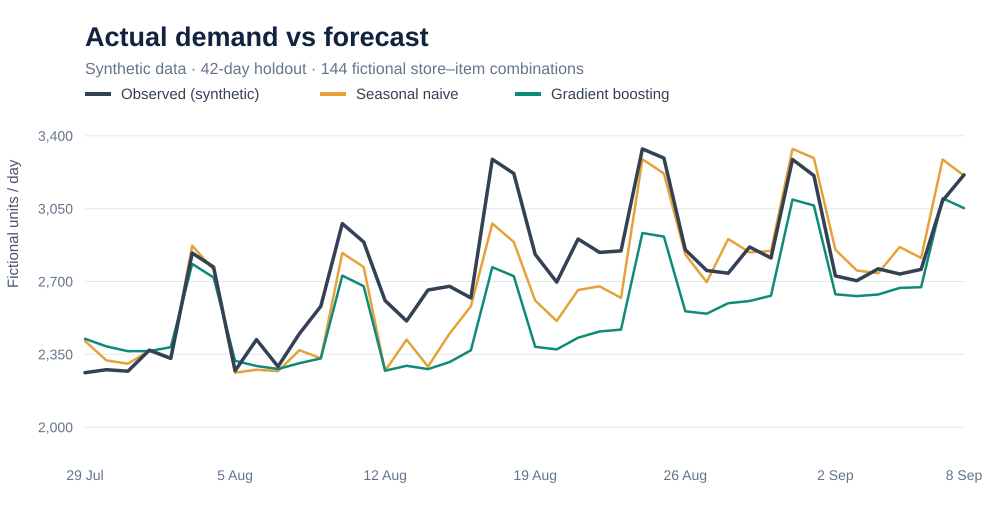
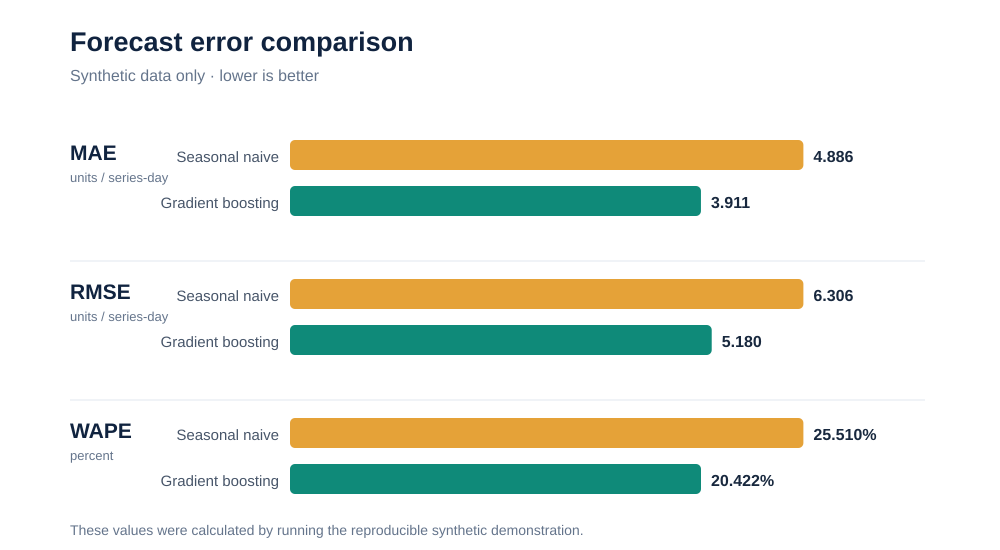
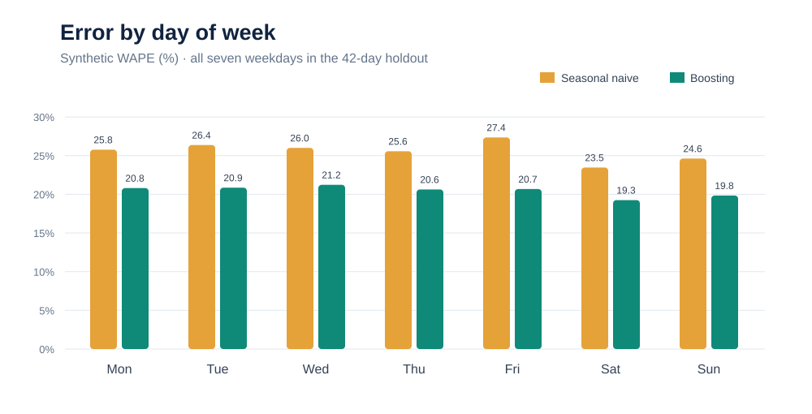

# Retail Item Demand Forecasting — Public Portfolio Demonstration

**Skills:** Python, pandas, NumPy, scikit-learn, time-series feature engineering, chronological validation, data governance

## Business question
Could forecasts of item quantities provide a useful input to future workload planning, compared with a simple seasonal-naive rule? The project investigates **demand forecasting**, not direct prediction of employee hours or a replacement for an operational labour model.

## Provenance: original project versus this public reconstruction
This is an **independent, reproducible reconstruction** of a previously completed academic proof of concept. It retains the broad analytical approach: daily store–item demand, a seven-day-ahead forecast, a seasonal-naive baseline, a gradient-boosted challenger and a held-out chronological test period.

**All data in this repository are newly generated and fictional.** IDs are invented, figures and dates are simulated, and any metrics produced by the code describe **this demo only**. They are **not** the results or data of the original organisational analysis. The original project used large-scale data preparation upstream; this public demo deliberately runs locally and does not claim to reproduce enterprise-scale distributed ingestion.

## Results and visual findings (synthetic demonstration)

The published example was **executed locally**, not just drafted. It generated **36,288 fictional store–item–day observations** (8 stores × 18 items × 252 days). The **final 42 days** (6,048 observations) were held out for testing. All six unit tests passed locally.

| Test metric | Seasonal naive | Gradient boosting | Relative improvement |
| --- | ---: | ---: | ---: |
| Mean absolute error (MAE) | 4.886 | **3.911** | **20.0%** |
| Root mean squared error (RMSE) | 6.306 | **5.180** | **17.9%** |
| Weighted absolute percentage error (WAPE) | 25.510% | **20.422%** | **19.9%** |
| Signed bias (predicted − observed) | −0.434 | −1.320 | **Worse underforecasting** |

**Important:** These are **simulated-data results, not measurements from the original employer project**. The improved average error does *not* establish commercial benefit. The more negative bias warns that the challenger underforecasted systematically in this holdout, potentially important where understaffing or shortages are costly.

### 1. Demand: actual versus forecast



The two methods follow weekly seasonality, but both miss some of the changing aggregate demand. The chart aggregates fictional item quantities across all series; the accuracy table above scores individual store–item–day predictions.

### 2. Comparison of forecasting errors



Gradient boosting has lower MAE, RMSE and WAPE than the simple weekly seasonal baseline on this synthetic holdout. **RMSE penalises larger misses more heavily** than MAE; WAPE places absolute error in the context of total demand.

### 3. Error by weekday



Gradient boosting improved demand-weighted absolute error on each weekday of this fictional test sample, but this is not a substitute for checking future seasonal periods or unexpected demand shifts.

**Read the full interpretation:** [Findings, limitations and decisions](FINDINGS.md).

## How the public version works
1. Generate synthetic item demand with weekly seasonality and different fictional stores and products.
2. Create demand features at lags of 7, 14 and 28 days, plus the mean of the most recent **fully observable** seven-day window (days t−13 through t−7).
3. Use the final 42 days for a chronological test; never shuffle the time series.
4. Compare **Seasonal Naive** (demand seven days ago) with **Histogram Gradient Boosting**.
5. Measure MAE, RMSE, WAPE and signed bias. Save test-set forecasts and a chart to a local `outputs/` directory.

No future observed demand is supplied to the challenger: every historical demand feature is at least seven days old relative to its forecasted date. This design supports a rolling seven-day-ahead interpretation, not a forecast that has seen transactions inside the horizon.

## Run locally

```bash
python -m pip install -r requirements.txt
python -m src.forecast
python -m src.create_figures
python -m unittest discover -s tests -v
```

Running the scripts generates metrics, synthetic test forecasts, and local chart files under `outputs/`, which is ignored by Git. The embedded SVG charts above are checked-in snapshots from the same seeded synthetic demonstration; `src.create_figures` independently renders fresh versions. You do not need internal data, a Databricks account, or a company network.

## Interpreting results and next steps
- Improvement over a naive forecast on synthetic data is **not** evidence of actual business savings.
- A dense set of fictional items does not establish performance for intermittent demand, seasonal peaks, promotions or new products.
- A true weekly planning experiment should fix a common forecast origin and use only the data available at that origin; this demo uses a rolling per-target-date seven-day horizon.
- Item forecasts would require further validation against cases, deliveries, work standards, and task-level requirements before being used for staffing.
- Future work: rolling-origin backtests, calibrated uncertainty, promotion calendars, hierarchical aggregation, and separately validated mapping to workload.

## Publication and confidentiality
No real store numbers, customer records, transaction tables, operational paths, internal documentation, credentials or proprietary screenshots are included. Do not add any non-public source data. See [PRIVACY.md](PRIVACY.md).

> Portfolio disclosure: the code in this public reconstruction was prepared with AI assistance and should be reviewed, understood, tested and adapted by the repository owner before describing it as independently implemented software.
