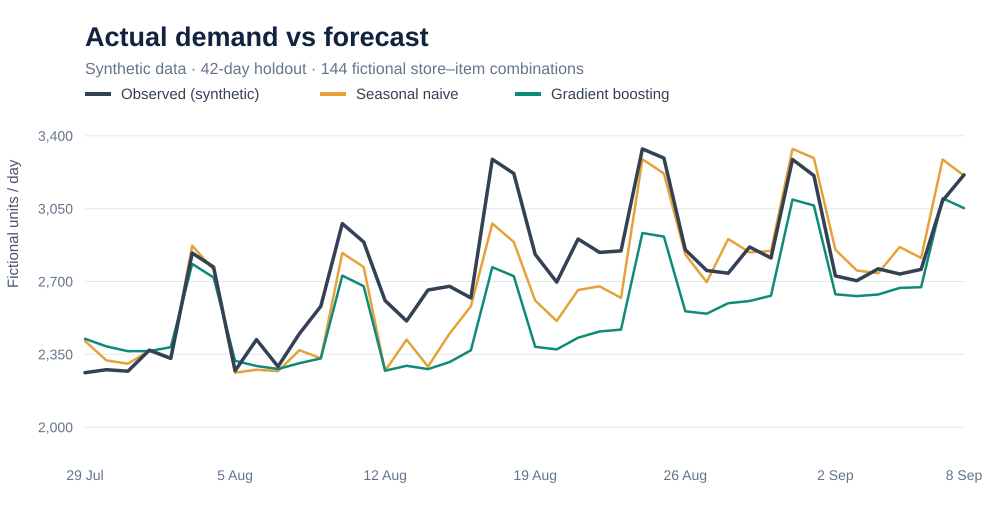
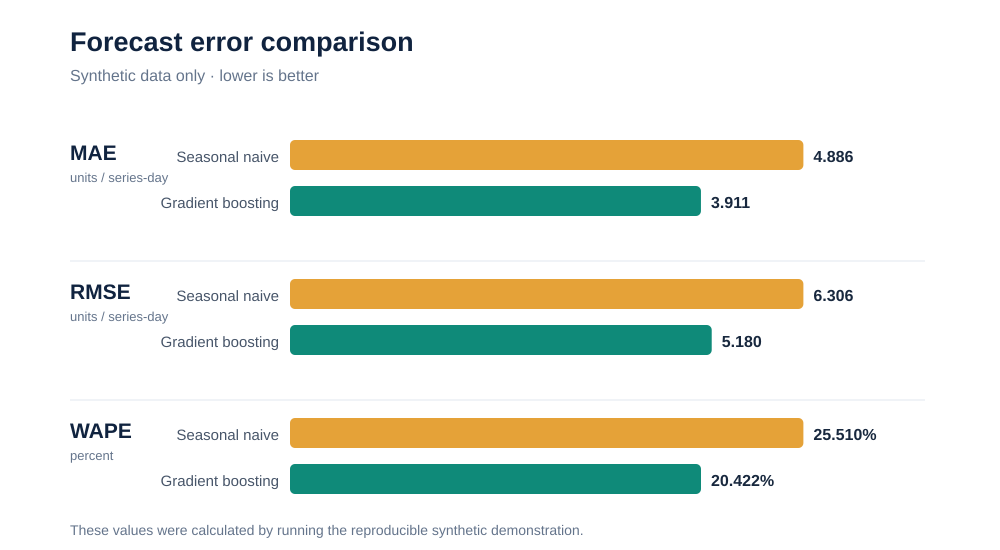
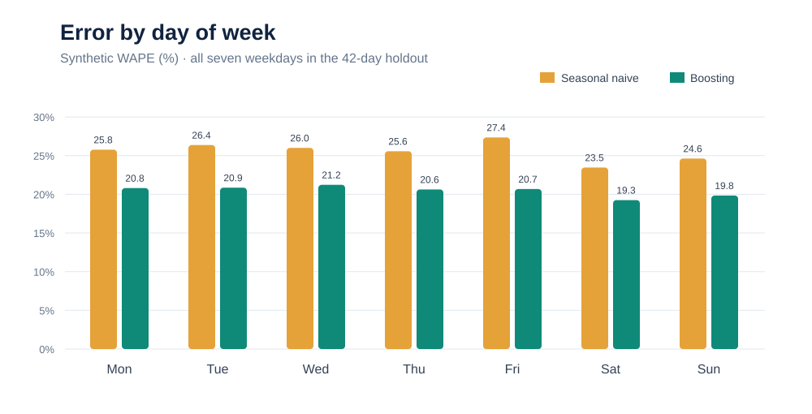

# Retail Item Demand Forecasting

**A reproducible seven-day-ahead forecasting experiment**  
Python · pandas · scikit-learn · Time-series validation · Machine learning

> **Public demonstration:** all store identifiers, product identifiers, dates and demand figures used in this case study are fictional. The charts report results from a newly generated synthetic dataset, **not actual retailer performance**.

## The business problem

Sales value alone does not fully describe the number and mix of items that need handling. Could a model forecasting item demand improve on a simple rule that repeats last week's observed quantities? Before connecting any forecast to workload decisions, the first step is to check whether a demand model beats a transparent benchmark.

This study tests **item-level demand forecasting**, not direct staffing or wage prediction.

## Executive summary

The public experiment creates 36,288 synthetic observations (8 stores × 18 items × 252 dates). The final 42 days, representing **6,048 store–item–day forecasts**, are reserved for out-of-time evaluation.

| Metric | Seasonal naive | Gradient boosting | Relative reduction |
| --- | ---: | ---: | ---: |
| MAE (units) | 4.886 | **3.911** | **20.0%** |
| RMSE (units) | 6.306 | **5.180** | **17.9%** |
| WAPE | 25.510% | **20.422%** | **19.9%** |
| Bias (predicted − observed, units) | −0.434 | −1.320 | **Worsened** |

**Headline:** the machine-learning challenger reduced average error on fictional data, but **underforecast more heavily**. That trade-off would need investigation before applying the approach to any real planning decision.

---

## 1. What happened to the forecast?

The lines show aggregated daily quantities across all fictional store–item combinations. The test scores above are calculated on **individual store–item–day observations**, where a good overall aggregate line can still hide significant local misses.

**Finding:** repeating the previous week's demand follows weekly seasonality, while Gradient Boosting tracks changing patterns better on average in this artificial sample.

## 2. Which model made fewer errors?

**Finding:** Gradient Boosting reduced MAE, RMSE and demand-weighted percentage error. The signed bias moved from −0.434 to −1.320, highlighting a potential operational issue: **a model can have lower absolute error yet systematically predict too few units**.

## 3. Was performance consistent through the week?

**Finding:** the model's WAPE was lower than the baseline for each weekday in the artificial holdout. There is no evidence from this demonstration about events, promotions, holidays, intermittent items or peak retail seasons.

---

## How the model was built

**Synthetic daily panel → lagged demand features → chronological holdout → seasonal-naive benchmark → gradient-boosted challenger → metrics and error analysis**

- **Inputs:** fictional store and product categories, forecast date, seven-, fourteen- and twenty-eight-day demand lags, and the most recent complete historical week.
- **Leakage control:** all observed-demand inputs are at least seven days old relative to each target date. For a target on day `t`, the rolling weekly mean uses days `t−13` through `t−7`.
- **Split:** earlier dates for training, last 42 calendar days for testing; no random holdout.
- **Metrics:** MAE, RMSE, WAPE and signed forecast bias.

The final run used a seeded data generator. The repository includes six passing unit tests and a script for recreating charts. It runs entirely locally, without any access to operational systems.

## Limitations and next steps

A simulated success does not imply a real-world improvement or a staffing saving. A production-grade study would need rolling-origin backtests over multiple quarters, known future promotional variables, intermittent item behaviour, uncertainty estimates and checks on the consequence of underforecasting.

The step from forecasted items to workload is **not** established by this experiment. That would require a separate evaluation of delivered cases, tasks and operational standards before considering an impact on resource allocation.

## Skills demonstrated

This case study shows a baseline-first modelling approach, demand feature engineering, chronology-safe evaluation, model interpretation, testing, data confidentiality and transparent communication of limitations.

[View Python source and technical README](README.md) · [Read detailed findings](FINDINGS.md) · [Privacy and publication safeguards](PRIVACY.md)

---

*Portfolio publication note: the public reconstruction, including code and explanation, was created with AI assistance and should be independently reviewed before being presented as personally implemented software.*
